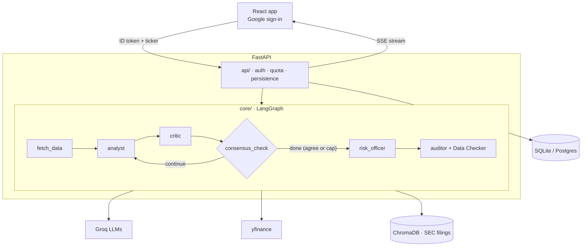

# Automated Financial Research & Multi-Agent Consensus Network

Sign in with Google, enter a stock ticker, and watch two AI agents argue about it live. An **Analyst** agent writes an investment thesis from market data and SEC filings; a **Critic** agent challenges it; they loop until they agree or hit a hard iteration cap. A **Risk Officer** agent names what could make the final thesis wrong, and an **Auditor** agent (LLM-as-a-Judge) checks every final claim against the retrieved SEC filing text, next to a code-only **Data Checker** for the numbers. You can also **compare 2-3 companies**: each gets the full treatment, then a **Comparator** agent weighs them side by side. Every run records what it cost (LLM calls, tokens, time per step). All financial reasoning lives in prompts; the code plumbs data in and validated, structured output out.

> Status: **Stages 0-9 complete**: deployed at **https://financial-consensus-agent.vercel.app** (Google sign-in → live Analyst/Critic debate over market data and 10-K excerpts → Risk Officer → Auditor fact-check + Data Checker → history; plus multi-company comparisons and per-run metrics). Free hosting: the first request after 15 idle minutes takes about a minute while the server wakes up.

## Architecture



Details: [docs/DESIGN.md](docs/DESIGN.md) · trade-offs: [docs/DECISIONS.md](docs/DECISIONS.md) · progress: [docs/PROGRESS.md](docs/PROGRESS.md)

## Tech stack

| Area | Tools |
|---|---|
| Backend | Python 3.11+, FastAPI, Uvicorn, SQLAlchemy 2 |
| AI | LangGraph, Groq (`gpt-oss-20b` for tool calling, `gpt-oss-120b` for reasoning), Pydantic v2 |
| Data | yfinance, SEC EDGAR filings (HTML, optional PDFs), ChromaDB; embeddings: local all-MiniLM-L6-v2 (dev) or Cohere `embed-english-v3.0` (deployed) |
| Auth | Google OAuth 2.0 (ID token verified server-side) |
| DB | SQLite locally, Postgres (Neon) when deployed, Alembic migrations |
| Frontend | React (Vite), Server-Sent Events |
| Deploy | Render (backend, Docker), Vercel (frontend), Neon (Postgres), GitHub Actions CI |

## Setup

### Windows (PowerShell)
```powershell
cd backend
python -m venv venv
venv\Scripts\activate
pip install -r requirements.txt
Copy-Item .env.example .env   # then edit .env with your values
```

### macOS / Linux
```bash
cd backend
python3 -m venv venv
source venv/bin/activate
pip install -r requirements.txt
cp .env.example .env          # then edit .env with your values
```

### Frontend (any OS, Node 20+)
```bash
cd frontend
npm install
cp .env.example .env          # Windows PowerShell: Copy-Item .env.example .env
```

### Google sign-in (one-time)
In Google Cloud Console → APIs & Services → Credentials, create an **OAuth client ID** of type **Web application** and add `http://localhost:5173` under **Authorized JavaScript origins**. Put the client ID in both `backend/.env` (`GOOGLE_CLIENT_ID`) and `frontend/.env` (`VITE_GOOGLE_CLIENT_ID`). Open the app at `http://localhost:5173` (not `127.0.0.1`), or Google will reject the origin.

## Environment variables (`backend/.env`)

| Variable | Needed from | Description |
|---|---|---|
| `GROQ_API_KEY` | Stage 2 | Groq API key |
| `GOOGLE_CLIENT_ID` | Stage 6 | OAuth client ID used to verify Google ID tokens |
| `DATABASE_URL` | Stage 0 | SQLAlchemy URL. Defaults to `sqlite:///backend/app.db` |
| `FRONTEND_ORIGIN` | Stage 6 | Allowed CORS origin, e.g. `http://localhost:5173` |
| `SEC_USER_AGENT` | Stage 4 | Name and contact email sent to SEC EDGAR (required by the SEC), e.g. `Jane Doe jane@example.com` |
| `APP_ENV` | Stage 8 | `development` (default) or `production`; production refuses to start if a setting is missing or malformed |
| `MAX_CONCURRENT_RUNS` | Stage 8 | Research runs executing at once across all users (default 2; 1 on the 512 MB host) |
| `EMBEDDING_PROVIDER` | Stage 8 | `local` (default, runs a small model on your machine) or `cohere` (hosted API, used in production) |
| `COHERE_API_KEY` | Stage 8 | Only when `EMBEDDING_PROVIDER=cohere` ([free trial key](https://dashboard.cohere.com/api-keys)) |

### Frontend (`frontend/.env`)

| Variable | Description |
|---|---|
| `VITE_API_URL` | Backend base URL, e.g. `http://localhost:8000` |
| `VITE_GOOGLE_CLIENT_ID` | The same Web OAuth client ID as the backend's `GOOGLE_CLIENT_ID` |

## Running

```powershell
cd backend
venv\Scripts\activate
pytest -v                                                     # offline tests (default)
pytest -m live                                                # tests that hit real yfinance / Groq
python -c "from src.db.session import init_db; init_db()"     # create local DB tables
python -m src.tools.market_data AAPL                          # print a market data snapshot as JSON
python -m src.core.tool_calling "How is Apple doing?"         # LLM picks the ticker, then fetches data
python -m src.core.graph AAPL 3                               # live Analyst/Critic debate, max 3 rounds
python -m src.core.comparison AAPL MSFT                       # live comparison (1 round per company)
python -m src.rag.retriever AAPL "supply chain risk"          # search the latest 10-K (downloads + indexes it on first use)
python -m src.rag.ingest path\to\10k.pdf AAPL 2025              # index a 10-K PDF you downloaded yourself
```

### Evals (standalone, not part of the app)

```powershell
cd backend
venv\Scripts\activate
python -m evals.run_evals --suite extraction        # request -> ticker (~1 min)
python -m evals.judge_calibration                   # auditor vs manual labels (~7 min on Groq free tier)
python -m evals.judge_calibration --repeats 3       # + consistency across repeats
python -m evals.run_evals --suite pipeline          # full live debates, code-checked (~15 min)
python -m evals.run_evals --suite data_check        # Data Checker vs manual labels (instant, no LLM)
python -m evals.run_evals --suite risk              # Risk Officer citations and focus (~2 min)
python -m evals.run_evals --suite compare_extraction  # comparison request -> tickers (~30 s)
```

Latest results (Groq free tier, `gpt-oss-120b`): extraction 4/4 · judge calibration 7/7 (precision 1.00, recall 1.00, claim recall 1.00) · pipeline 3/3 code checks passed, 2/3 forced exits, ~170 s per run · Stage 9: data_check 12/12 · risk 2/2 · compare_extraction 4/4. Read the limitations below before trusting the judge score.

Results are printed and saved to `backend/evals/results/` (gitignored). See [docs/DESIGN.md](docs/DESIGN.md#10-evaluation-harness-stage-5).

### API server

```powershell
cd backend
venv\Scripts\activate
uvicorn src.main:app --reload            # http://127.0.0.1:8000, interactive docs at /docs
```

| Endpoint | Auth | Purpose |
|---|---|---|
| `POST /research` | Bearer | Start a run: `{"query": "How is Apple doing?", "max_iterations": 2}` → `202 {run_id, ticker}` |
| `POST /compare` | Bearer | Compare 2-3 companies: `{"query": "Apple vs Microsoft"}` → `202 {run_id, ticker: "AAPL vs MSFT"}` |
| `GET /research/{id}/stream` | Bearer | Server-Sent Events: `fetch_data`, `analyst`, `critic`, `consensus_check`, `risk_officer`, `auditor`, and for comparisons `comparator` (each per-company event carries `ticker`), or `error`, then `end`. Supports `Last-Event-ID` |
| `GET /research/{id}` | Bearer | Run status, kind (`single`/`compare`), all events, final output, metrics |
| `GET /history` | Bearer | Your runs, newest first |
| `GET /me` | Bearer | Your account and quota usage |
| `GET /health` | none | Liveness check |

Every authenticated call needs `Authorization: Bearer <Google ID token>` (the React frontend in Stage 7 obtains it with Google sign-in). Quota: 1 active run and 5 runs per rolling 24 hours per user; a comparison counts as one run per company.

### Frontend

Start the backend (above), then in a second terminal:

```bash
cd frontend
npm run dev                   # http://localhost:5173
npm test                      # Vitest unit + component tests
npm run lint                  # oxlint
npm run build                 # type check + production build into dist/
```

Sign in with Google, ask about a company (e.g. "How is Apple doing?"), and watch the Analyst, Critic and Auditor steps arrive live. Past runs are under **History**.

## Deployment

Live: **https://financial-consensus-agent.vercel.app** (API: `https://financial-consensus-api.onrender.com`, `GET /health`).

| Piece | Where | Defined in |
|---|---|---|
| Frontend | Vercel (root directory `frontend`) | `frontend/vercel.json`: SPA rewrite + CSP and security headers |
| Backend | Render free web service, Docker | `render.yaml` (Blueprint) + `backend/Dockerfile`: runs `alembic upgrade head`, then Uvicorn, as a non-root user |
| Database | Neon Postgres 17 | `DATABASE_URL` (direct, non-pooled connection string) |
| CI | GitHub Actions | `.github/workflows/ci.yml`: backend tests, Postgres tests, frontend lint/test/build, image build + in-container probes |

To deploy your own copy:

1. Create a Neon project and copy its direct connection string.
2. In Render: **New → Blueprint** on this repo. Enter `GROQ_API_KEY`, `GOOGLE_CLIENT_ID`, `DATABASE_URL`, `FRONTEND_ORIGIN`, `SEC_USER_AGENT` and `COHERE_API_KEY` when asked, in the dashboard only. `APP_ENV=production`, `MAX_CONCURRENT_RUNS=1` and `EMBEDDING_PROVIDER=cohere` come from `render.yaml`.
3. In Vercel: import the repo with root directory `frontend`, and set `VITE_API_URL` (the Render URL) and `VITE_GOOGLE_CLIENT_ID`. If your Render URL differs, update `connect-src` in `frontend/vercel.json`.
4. Set Render's `FRONTEND_ORIGIN` to the Vercel production URL (comma-separate several, e.g. `https://your-app.vercel.app,http://localhost:5173`), and add the same URL to the OAuth client's **Authorized JavaScript origins** in Google Cloud.

Pushing to `main` redeploys both services. Secrets live only in the Render and Vercel dashboards and in local `.env` files, never in git.

## Project status

| Stage | Description | Status |
|---|---|---|
| 0 | Design, schemas, GraphState, DB models | ✅ Done |
| 1 | Data ingestion (yfinance) | ✅ Done |
| 2 | Tool calling + structured extraction (Groq) | ✅ Done |
| 3 | LangGraph Analyst/Critic loop with iteration guardrail | ✅ Done |
| 4 | RAG over SEC filings (ChromaDB) | ✅ Done |
| 5 | Auditor (LLM-as-a-Judge) + eval harness | ✅ Done |
| 6 | FastAPI: Google auth, quota, persistence, SSE | ✅ Done |
| 7 | React frontend | ✅ Done |
| 8 | Deployment + hardening | ✅ Done |
| 9 | Extensions: observability, Risk Officer + Data Checker, multi-company comparison | ✅ Done |

## Honest limitations

- Not investment advice. LLM output can be wrong even when the Auditor marks it grounded; the Auditor is itself an LLM and is calibrated, not perfect.
- The Auditor scored 7/7 on the hand-labelled judge cases, but those cases are small and clean. On real pipeline outputs, a manual check found about 2 of its 9 flags were false alarms caused by its own arithmetic/unit mistakes (precision ≈ 0.7). Numeric claims should eventually be checked in code.
- The eval set is small (14 cases, one frozen AAPL snapshot for judge cases), so scores move a lot with one case. Critic objection quality is not evaluated yet.
- Ticker extraction declines non-US companies (`no_us_listing`), but it is still an LLM judgement and can be wrong in either direction.
- US tickers only (no exchange suffixes such as `.NS`).
- yfinance is an unofficial data source and can break or rate-limit.
- Free-tier Groq rate limits cap throughput: `gpt-oss-120b` allows 8k tokens/minute and one agent call uses ~5k, so a 2-round debate takes about 2 minutes.
- RAG uses only the latest 10-K (no 10-Qs or news) and only Items 1, 1A, 1C, 3, 7 and 7A; financial statement tables (Item 8) are not indexed. An indexed filing is not refreshed automatically when a newer 10-K comes out.
- Filing excerpts are the company's own disclosures, not independent verification.
- Runs execute in a thread pool inside the API process: one at a time when deployed (2 locally). A run in progress is lost (marked failed) if the server restarts or redeploys, and the API must run as a single instance until a real job queue is added.
- Free hosting: the server sleeps after 15 idle minutes (the next request waits about a minute), and its disk is wiped on every sleep and deploy. A ticker's first run after that re-downloads and re-indexes its 10-K (about 30 s with Cohere).
- Deployed filing embeddings use Cohere's trial key: filing text is sent to Cohere, and the key allows about 1,000 calls a month (roughly 100 first-time 10-Ks). If indexing takes over 2 minutes or fails, the run continues without 10-K excerpts.
- The Risk Officer's risks and the Comparator's verdict are LLM output that is **not** audited (the Auditor checks the analyst's thesis only). In a live AAPL vs MSFT test the Comparator stated a wrong derived number (Apple "net cash" instead of net debt); the prompt now requires inputs for derived numbers, and the UI labels the comparison as not fact-checked.
- The Data Checker only checks `field = value` data points against the market data; prose claims, derived numbers and periods (quarterly vs annual) remain the Auditor's job.
- A comparison researches companies one after another with 1 debate round each: about 3-4 minutes per company on the free tier.
- Section splitting is heuristic: for Microsoft's 10-K, "Item 7" currently picks up the wrong text, so MSFT runs get weaker MD&A evidence.
- The live stream polls the database every 0.5 s (simple and robust, but not built for many concurrent viewers).
- Sign-in lasts about an hour (Google ID token lifetime, no refresh tokens); after that you sign in again. The token lives in `sessionStorage`, protected by a strict Content-Security-Policy, so an XSS hole would still be serious.
- While a run is live, citation chips show the excerpt id only; the excerpt text appears once the run finishes.
- Locally, the first RAG run downloads a ~80 MB embedding model and the 10-K, and embedding a 10-K takes a few minutes on a laptop CPU.
- The debate loop is capped at `max_iterations` rounds (default 3); a forced exit is reported as unresolved disagreement rather than consensus.
- A Critic "agreeing" is an LLM judgement, not proof the thesis is right; the Critic can be too lenient.
- On Groq's free tier, the reasoning model hits rate limits within a single debate; calls are retried with backoff, so runs can take a minute or more.

## License

[MIT](LICENSE)
