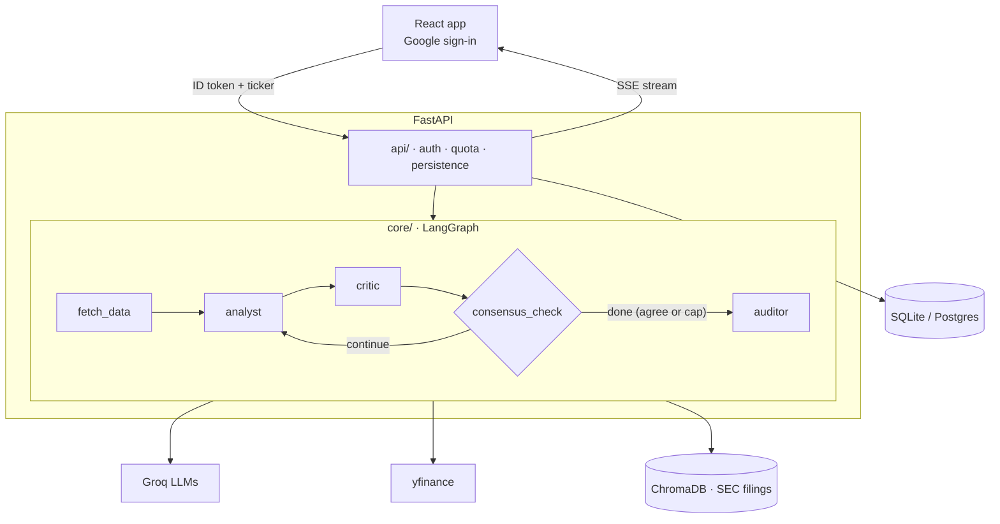

# Automated Financial Research & Multi-Agent Consensus Network

Sign in with Google, enter a stock ticker, and watch two AI agents argue about it live. An **Analyst** agent writes an investment thesis from market data and SEC filings; a **Critic** agent challenges it; they loop until they agree or hit a hard iteration cap. An **Auditor** agent (LLM-as-a-Judge) then checks every final claim against the retrieved SEC filing text and flags anything unsupported. All financial reasoning lives in prompts; the code plumbs data in and validated, structured output out.

> Status: **Stages 0-3 complete** (design, schemas, DB models, market data, LLM tool calling, Analyst/Critic debate loop with iteration cap). Later stages are planned below.

## Architecture



Details: [docs/DESIGN.md](docs/DESIGN.md) · trade-offs: [docs/DECISIONS.md](docs/DECISIONS.md) · progress: [docs/PROGRESS.md](docs/PROGRESS.md)

## Tech stack

| Area | Tools |
|---|---|
| Backend | Python 3.11+, FastAPI, Uvicorn, SQLAlchemy 2 |
| AI | LangGraph, Groq (`gpt-oss-20b` for tool calling, `gpt-oss-120b` for reasoning), Pydantic v2 |
| Data | yfinance, SEC filings (PDF), ChromaDB |
| Auth | Google OAuth 2.0 (ID token verified server-side) |
| DB | SQLite locally, Postgres when deployed |
| Frontend | React (Vite), Server-Sent Events |
| Deploy | Render/Railway/Fly.io (backend), Vercel/Netlify (frontend) |

## Setup

### Windows (PowerShell)
```powershell
cd backend
python -m venv venv
venv\Scripts\activate
pip install -r requirements.txt
Copy-Item .env.example .env   # then edit .env with your values
```

### macOS / Linux
```bash
cd backend
python3 -m venv venv
source venv/bin/activate
pip install -r requirements.txt
cp .env.example .env          # then edit .env with your values
```

## Environment variables (`backend/.env`)

| Variable | Needed from | Description |
|---|---|---|
| `GROQ_API_KEY` | Stage 2 | Groq API key |
| `GOOGLE_CLIENT_ID` | Stage 6 | OAuth client ID used to verify Google ID tokens |
| `DATABASE_URL` | Stage 0 | SQLAlchemy URL. Defaults to `sqlite:///backend/app.db` |
| `FRONTEND_ORIGIN` | Stage 6 | Allowed CORS origin, e.g. `http://localhost:5173` |

## Running

```powershell
cd backend
venv\Scripts\activate
pytest -v                                                     # offline tests (default)
pytest -m live                                                # tests that hit real yfinance / Groq
python -c "from src.db.session import init_db; init_db()"     # create local DB tables
python -m src.tools.market_data AAPL                          # print a market data snapshot as JSON
python -m src.core.tool_calling "How is Apple doing?"         # LLM picks the ticker, then fetches data
python -m src.core.graph AAPL 3                               # live Analyst/Critic debate, max 3 rounds
```

Backend server, frontend and evals: added in Stages 6, 7 and 5.

## Project status

| Stage | Description | Status |
|---|---|---|
| 0 | Design, schemas, GraphState, DB models | ✅ Done |
| 1 | Data ingestion (yfinance) | ✅ Done |
| 2 | Tool calling + structured extraction (Groq) | ✅ Done |
| 3 | LangGraph Analyst/Critic loop with iteration guardrail | ✅ Done |
| 4 | RAG over SEC filings (ChromaDB) | Planned |
| 5 | Auditor (LLM-as-a-Judge) + eval harness | Planned |
| 6 | FastAPI: Google auth, quota, persistence, SSE | Planned |
| 7 | React frontend | Planned |
| 8 | Deployment + hardening | Planned |
| 9 | Extensions | Planned |

## Honest limitations

- Not investment advice. LLM output can be wrong even when the Auditor marks it grounded; the Auditor is itself an LLM and is calibrated, not perfect.
- US tickers only (no exchange suffixes such as `.NS`).
- yfinance is an unofficial data source and can break or rate-limit.
- Free-tier Groq rate limits cap throughput.
- The debate loop is capped at `max_iterations` rounds (default 3); a forced exit is reported as unresolved disagreement rather than consensus.
- A Critic "agreeing" is an LLM judgement, not proof the thesis is right; the Critic can be too lenient.
- On Groq's free tier, the reasoning model hits rate limits within a single debate; calls are retried with backoff, so runs can take a minute or more.

## License

[MIT](LICENSE)
