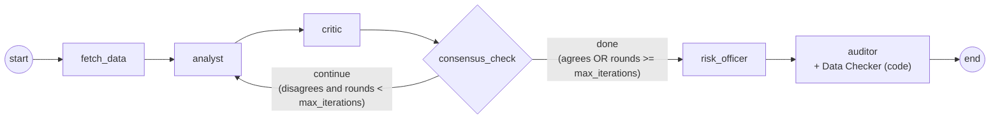
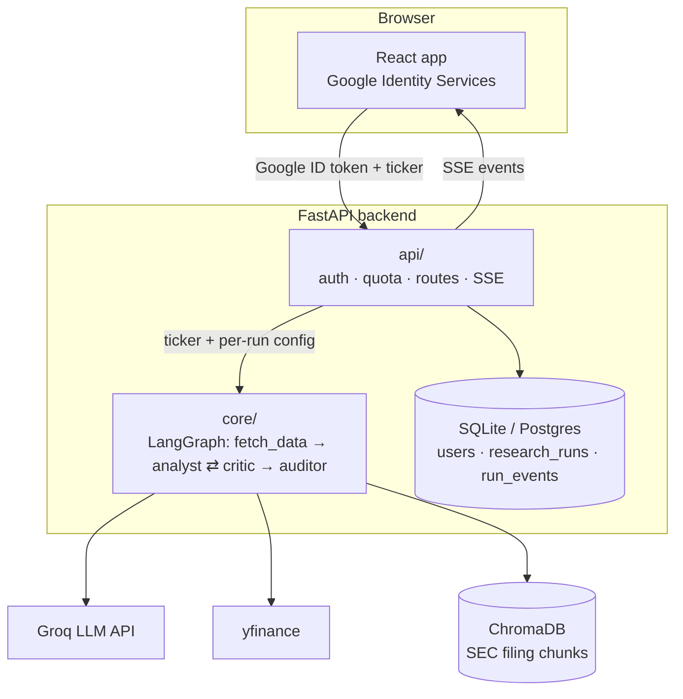
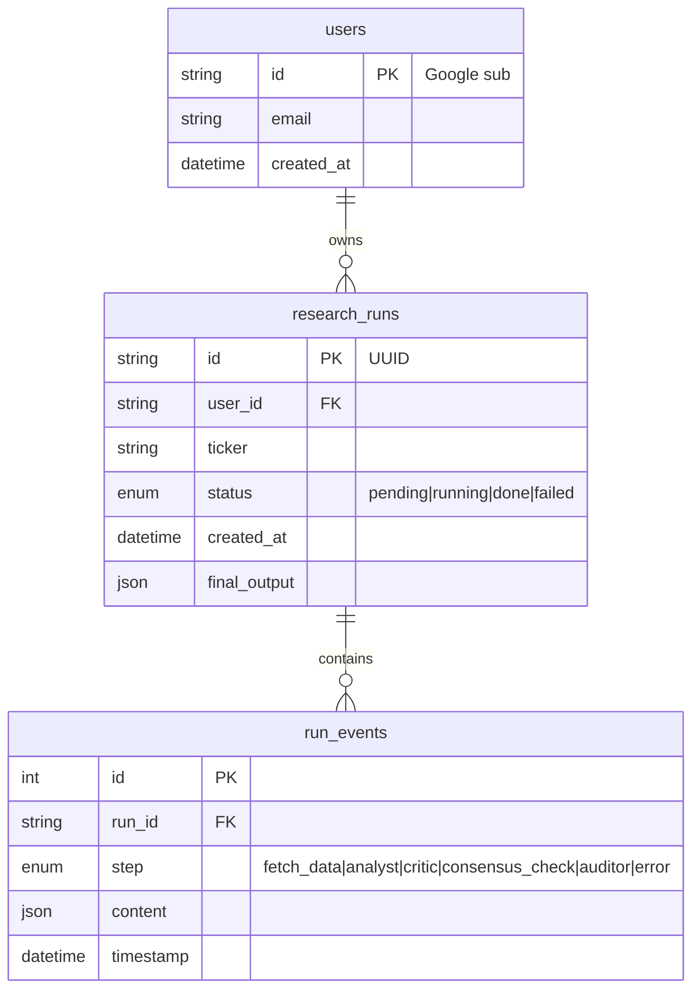
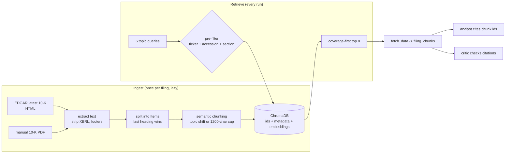
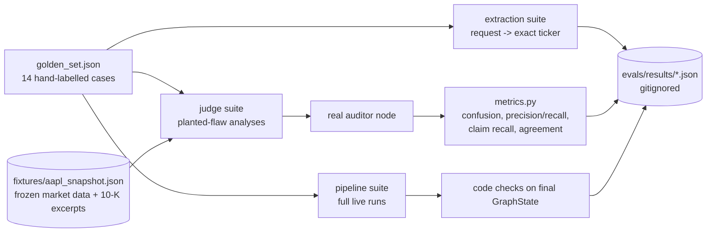
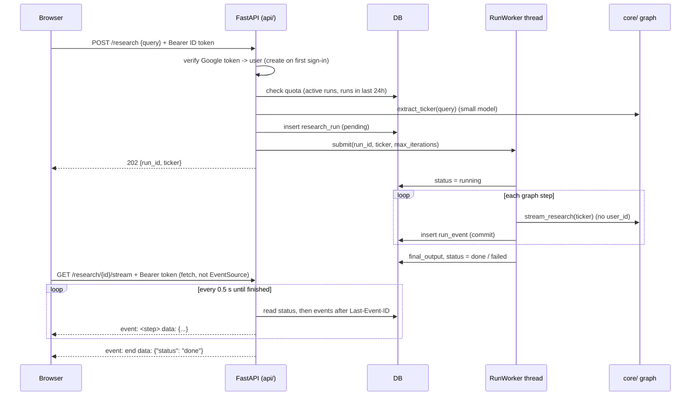
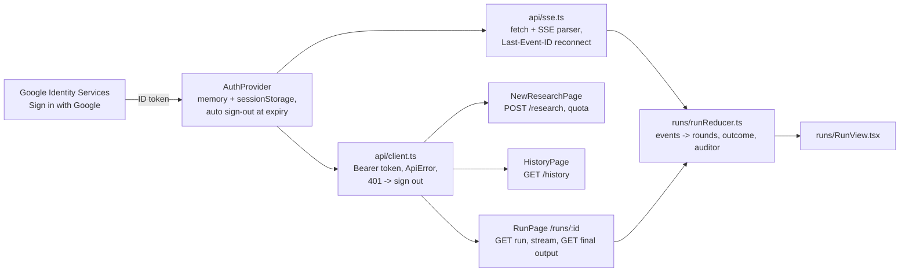
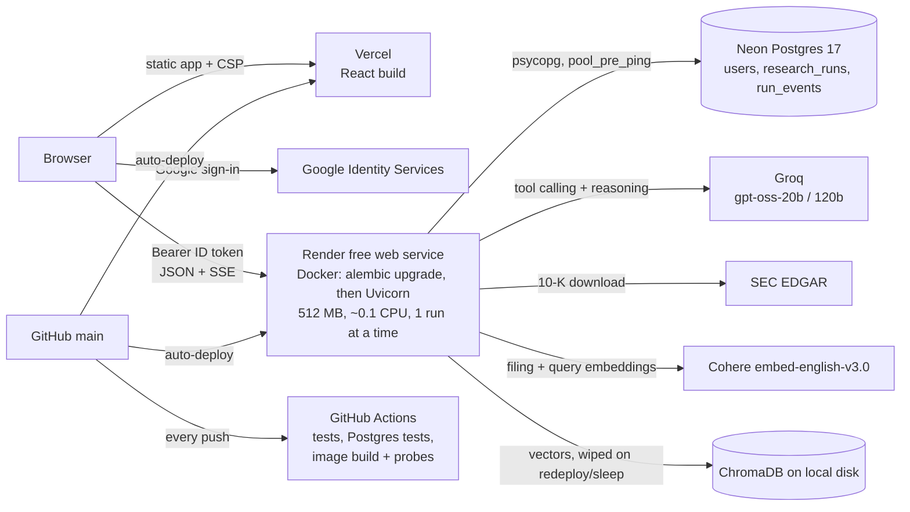
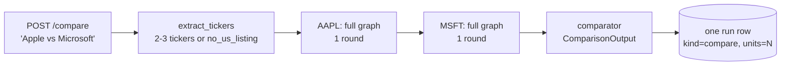

# Design: Automated Financial Research & Multi-Agent Consensus Network

## 1. Scope

**In scope**
- A user signs in with Google, submits a US stock ticker, and watches a live debate between an **Analyst** agent and a **Critic** agent.
- The debate is a LangGraph loop with a hard **iteration cap** (guardrail).
- An **Auditor** agent (LLM-as-a-Judge) checks the final claims against retrieved SEC filing text.
- Each step streams to a React UI over Server-Sent Events (SSE) and is stored per user (history page).
- A standalone eval harness (golden set + judge calibration) measures quality offline.

**Out of scope**
- Investment advice, trading or portfolio features.
- Real-time tick data; yfinance snapshots are enough.
- Non-US exchanges (tickers with exchange suffixes like `RELIANCE.NS` are rejected).
- Our own financial logic: all financial reasoning lives in LLM prompts (`core/prompts.py`). Code only moves data in and validated structured output out.

## 2. Agent graph

- `fetch_data`: pulls market data (yfinance) and relevant SEC filing chunks (ChromaDB) into state.
- `analyst`: produces an `AnalystOutput` (thesis, data points, reasoning, confidence, citations).
- `critic`: produces `CriticFeedback` (agrees, objections, missing context).
- `consensus_check` (guardrail). `max_iterations` = maximum Analyst rounds **in total** (default 3); `iteration_count` = completed rounds.
  - After each critic step, the `consensus_check` node increments `iteration_count` and sets `forced_exit=True` if the cap is reached while the Critic still disagrees.
  - The router then returns `"done"` if `critic_feedback.agrees` is true, **or** if `iteration_count >= max_iterations`; otherwise `"continue"` (back to `analyst`).
  - Split into node + router because LangGraph routing functions cannot update state.
  - Backstop: `recursion_limit = 3 + 3 x max_iterations + 1` steps (fetch_data, risk_officer and auditor outside the loop), so even a broken router cannot loop beyond about one extra round.
  - A forced exit still goes to the Auditor and is flagged as **unresolved disagreement**, so the UI and stored result never present a forced exit as consensus.
- `risk_officer` (Stage 9): runs once after the debate. It sees the evidence, the final analysis and how the debate ended (unresolved objections included), and produces a `RiskAssessment`: 1-5 risks with severity and a validated excerpt citation (or null for market-data risks), the conditions that would change the thesis, and the overall risk.
- `auditor` (LLM-as-a-Judge): runs after every debate, consensus or forced exit. It sees the final `AnalystOutput` and the same evidence the agents had, but **not** the critic's feedback, so its verdict is independent. It produces an `AuditorVerdict` (is_grounded, unsupported_claims, notes). A verdict whose `is_grounded` contradicts its `unsupported_claims` list gets one repair attempt. The same step runs the **Data Checker** (code, no LLM): each analyst `field = value` data point is looked up in the market data and marked match / mismatch / unknown field / not checkable. It is shown next to the verdict, not given to the Auditor (D66).

Why a hard cap: two LLMs can disagree forever. Without a cap, cost and latency are unbounded and a run might never finish.

## 3. System architecture

## 4. Separation of concerns: `core/` vs `api/`

| Layer | Knows about | Does not know about |
|---|---|---|
| `core/` (graph, nodes, schemas, prompts) | tickers, market data, filings, LLM calls | users, auth, HTTP, the database |
| `api/` (auth, quota, routes) | users, tokens, quotas, persistence, streaming | how the agents reason |

- `core/` takes a ticker (plus optional run config) and returns a final `GraphState`. It never sees `user_id`.
- `api/` verifies the user, checks the quota **before** invoking the graph, persists each step as a `run_event`, and streams it.
- Per-user settings (for example a model tier) are passed into `GraphState` as plain parameters by the API layer.

Benefits: `core/` can be unit tested and evaluated (Stage 5 harness) without a web server or database, and auth bugs cannot leak into the reasoning code.

## 5. Authentication decision

**Choice:** Google Identity Services on the frontend issues a Google **ID token** (a signed JWT). The frontend sends it as `Authorization: Bearer <token>` on every request. FastAPI verifies it with `google-auth` (`id_token.verify_oauth2_token`): signature, expiry, issuer, and audience = our `GOOGLE_CLIENT_ID`. The token's `sub` claim becomes `users.id`.

- Stateless: no server-side sessions or our own JWTs to manage.
- No passwords stored.
- `sub` is stable for a Google account; email can change, so email is not the key.
- Trade-off: ID tokens expire after about 1 hour, so the frontend must refresh them; SSE needs the token too (handled in Stage 6/7).

## 6. Data model

- Every query is scoped by `user_id`; there are no cross-user reads. Scoped helpers live in `db/models.py` and are tested.
- Run ids are random UUIDs so they cannot be guessed from the SSE URL (ownership is still checked).

## 7. RAG over SEC filings (Stage 4)

- **Sources:** the latest 10-K from SEC EDGAR (HTML/inline XBRL) is downloaded automatically. A 10-K PDF can also be indexed by hand (`python -m src.rag.ingest`). Both go through the same chunker.
- **Sections:** each 10-K Item heading appears twice (table of contents, then the real section); the last occurrence marks the section start. Only Items 1, 1A, 1C, 3, 7 and 7A are indexed.
- **Semantic chunking:** paragraphs within a section are embedded. A chunk ends where neighbouring-paragraph similarity is in the section's lowest 20% (and below its median), or at 1,200 characters. Size-based breaks repeat one paragraph as overlap; tiny chunks are merged into a neighbour.
- **Metadata pre-filtering:** every vector query filters on `ticker`, `accession` (one filing) and `section` before ranking, so another company's or another year's text can never be returned.
- **Citations:** chunk ids such as `AAPL-10K-2025-1A-007` are deterministic. The Analyst must cite only ids it was given; this is enforced in code (`extra_check` → one repair attempt). The Critic sees the same excerpts. The Auditor then checks that citations actually support the claims.
- **Failure mode:** a missing filing (ETF, foreign issuer, EDGAR down) logs a warning and the debate runs on market data only.

## 8. Structured output contracts (Pydantic v2)

- `AnalystOutput`: thesis, supporting_data_points, reasoning, confidence (`low|medium|high`), filing_citations (default `[]`)
- `CriticFeedback`: agrees, objections, missing_context
- `AuditorVerdict`: is_grounded, unsupported_claims, notes
- `MarketDataToolInput`: ticker, normalized to uppercase, non-empty, no exchange suffix
- LLM-output models forbid extra fields so malformed or hallucinated output fails validation loudly instead of passing silently.

## 9. Streaming

`POST /research` creates a run (after the quota check) and returns its id. `GET /research/{id}/stream` opens an SSE stream; each graph step is saved as a `run_event` and pushed as an SSE message. `GET /history` lists the user's past runs. Implementation details are in section 11.

## 10. Evaluation harness (Stage 5)

`backend/evals/` is a standalone tool for measuring quality. It is **not** part of the live app; nothing in `src/` imports it.

- **Extraction suite (4 cases):** a free-text request must give an exact ticker. One case (a company listed only in India) must fail cleanly, either at extraction or because the invented ticker does not exist.
- **Judge suite (7 cases):** each case is a hand-written analysis containing one planted flaw:
  - a wrong number;
  - a unit misread;
  - a period misread;
  - a citation that doesn't support its claim;
  - outside knowledge.

  Two control cases are grounded: one fully grounded analysis, and one that contains only opinions. The cases are checked against a **frozen** evidence snapshot, so labels stay correct after prices move or a new 10-K comes out. Each label holds by construction and is explained in the case's `notes` field.
- **Pipeline suite (3 cases):** full live runs (extraction → debate → auditor) for AAPL, MSFT and JPM. Each run is scored by code checks:
  - correct ticker and sector;
  - filings retrieved;
  - citations valid;
  - rounds within the cap;
  - `forced_exit` consistent with the critic's last verdict;
  - auditor ran.
- **Judge calibration** (`judge_calibration.py`) compares the auditor's verdicts with the manual labels.
  - The positive class is **ungrounded**: precision is "when it flags, is it right?" and recall is "how many planted flaws does it catch?".
  - It also reports **claim recall**: whether the auditor named the planted claim, not just the verdict.
  - With `--repeats N` it reports **agreement**: whether it gives the same verdict every time.

## 11. API (Stage 6)

| Endpoint | Purpose |
|---|---|
| `POST /research` | Start a run: `{query, max_iterations≤3}` → 202 `{run_id, ticker}`. 401 / 422 / 429 / 503 on errors |
| `GET /research/{id}/stream` | SSE: one event per graph step (`fetch_data`, `analyst`, `critic`, `consensus_check`, `auditor`, `error`), then `end`. Resumes from `Last-Event-ID` |
| `GET /research/{id}` | Run detail: status, events, `final_output` |
| `GET /history` | The user's runs, newest first (ticker, status, outcome, thesis) |
| `GET /me` | User + quota usage |
| `GET /health` | Liveness (no auth) |

- **Auth:** every endpoint except `/health` requires `Authorization: Bearer <Google ID token>`. Another user's run id returns **404**, so the API doesn't confirm the run exists.
- **Background worker:** a bounded in-process thread pool (`MAX_CONCURRENT_RUNS = 2`). Every graph step is committed as a `run_event`, so the stream can replay it and a reconnect can resume. On startup, runs still `pending`/`running` are marked failed with an error event, because the previous process can't resume them.
- **Stream ordering detail:** each poll reads the run **status before** the new events. The worker commits every event before it marks the run finished, so a finished status guarantees all events are visible. The other order could end the stream one event early.
- **Quota:** at most 1 active run and 5 runs per rolling 24 hours per user. It is checked before any LLM call. A failed ticker extraction creates no run and costs no quota.
- **Failure messages:** errors are stored as a user-safe message plus the exception type, never a stack trace.

## 12. Frontend (Stage 7)

React 19 + TypeScript + Vite, `react-router-dom`, plain CSS. Tests use Vitest + Testing Library (jsdom).

| Route | Page |
|---|---|
| (signed out) | `LoginPage`: Google's button only |
| `/` | `NewResearchPage`: query, example chips, max rounds 1–3, quota used, server errors (422/429/503) |
| `/runs/:runId` | `RunPage`: loads the run, then streams (or replays) its events into `RunView`, then fetches the final output so citation chips can show excerpt text |
| `/history` | `HistoryPage`: the user's runs with status, outcome and thesis |

- **Token handling:** the Google ID token is held in React state and in `sessionStorage` (this tab only).
  - The payload is decoded **only** to show the user's email and to schedule the automatic sign-out about a minute before expiry.
  - The backend verifies the token on every request.
  - Any 401 signs the user out.
- **Live stream:** `streamRun()` reads `GET /research/{id}/stream` with `fetch()`, because `EventSource` cannot send the Authorization header.
  - An incremental `SSEParser` handles messages split across network chunks, and ignores heartbeat comments.
  - If the connection drops without an `end` event, it reconnects with `Last-Event-ID`, up to 3 times. HTTP errors such as 404 are not retried.
- **One reducer for live and replay:** `runReducer` groups events into rounds (analyst → critic → result) and records the auditor verdict and errors. It ignores event ids it has already applied, so a live run, a reconnect and a finished run replayed from history all render identically.
- **Configuration:** `frontend/.env` holds `VITE_API_URL` and `VITE_GOOGLE_CLIENT_ID` (gitignored; `.env.example` is committed). The dev server is pinned to port 5173, which must match the backend's `FRONTEND_ORIGIN` and the OAuth client's authorized JavaScript origin.

## 13. Deployment (Stage 8)

- **Configuration as code:**
  - `render.yaml` (Blueprint) defines the service. Secrets are `sync: false`, so they are entered only in the Render dashboard.
  - `frontend/vercel.json` adds the SPA rewrite and the security headers. Its CSP allows only Google Identity Services and the Render API URL.
  - The repo holds no secrets; only `.env.example` files with placeholders are committed.
- **Startup:**
  - The container runs `alembic upgrade head` and then Uvicorn, as a non-root user.
  - With `APP_ENV=production`, the app refuses to start if a setting is missing or malformed (D57).
  - It logs the allowed CORS origins.
- **Request path:**
  - `UnhandledErrorMiddleware` sits inside `CORSMiddleware`, so even a crash returns a 500 the browser can read.
  - `SecurityHeadersMiddleware` adds `nosniff`, `DENY`, `no-referrer` and a `default-src 'none'` CSP.
- **Database sessions:** each read ends its transaction as soon as it's done, including after sign-in and in the worker between steps. A long SSE stream never holds a transaction open, and Neon terminates idle transactions (D63).
- **Embeddings:** `EMBEDDING_PROVIDER=cohere` in production and `local` everywhere else (D62). First-time ingestion of a 10-K takes about 30 s. `fetch_data` waits at most 120 s and otherwise continues without excerpts.
- **Limits that follow from the free tiers:**
  - the service sleeps after 15 minutes idle (the first request after that takes about a minute);
  - ChromaDB and downloaded filings are lost on every sleep and deploy, so a ticker's first run after a wake-up re-indexes its 10-K;
  - one research run executes at a time.

## 14. Extensions (Stage 9)

### Observability
- **Collector:** the worker opens a `RunMetrics` collector per run (`observability.run_context`, a context variable). `GroqClient` reports calls, retries and token usage; the embedders report calls; first-time 10-K ingestion reports its phase timings; the worker records each step's duration.
- **Threads:** LangGraph's node threads and the ingestion thread (`copy_context()`) report to the same collector.
- **Where it goes:**
  - stored in `research_runs.metrics`;
  - returned by `GET /research/{id}`;
  - shown in a collapsible **Run details** panel;
  - log lines written during a run carry ` [run=<id8>]`.
- **Missing 10-K:** `fetch_data` reports `filing_status` (`found` / `empty` / `unavailable` / `timeout`), and the UI explains when a run had no 10-K text.

### Multi-ticker comparison

- **Core:** `core/comparison.stream_comparison` runs the normal graph for each ticker in turn and yields `(ticker, node, update)`, then one Comparator call over compact briefs (no price history, only cited excerpts of up to 400 characters). Checks: `per_ticker` in the given order, `preferred` among the tickers or null, citations among the shown ids.
- **API:** one `research_runs` row with `kind="compare"`, `tickers`, `units=N` and the label "AAPL vs MSFT".
  - The quota sums units, checked before extraction (minimum 2) and again under the row lock.
  - The run timeout and stuck-run expiry scale with N.
- **Events:** each per-company event carries `content.ticker`. The final output holds `per_ticker` results, the `comparison` and all excerpts.
- **UI:** `compareReducer` sends each company's events through the normal `runReducer`. The run page shows a Comparison card (marked as not fact-checked) above one tab per company, with a single activity line.
