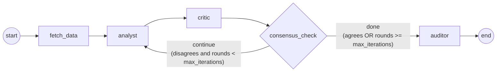
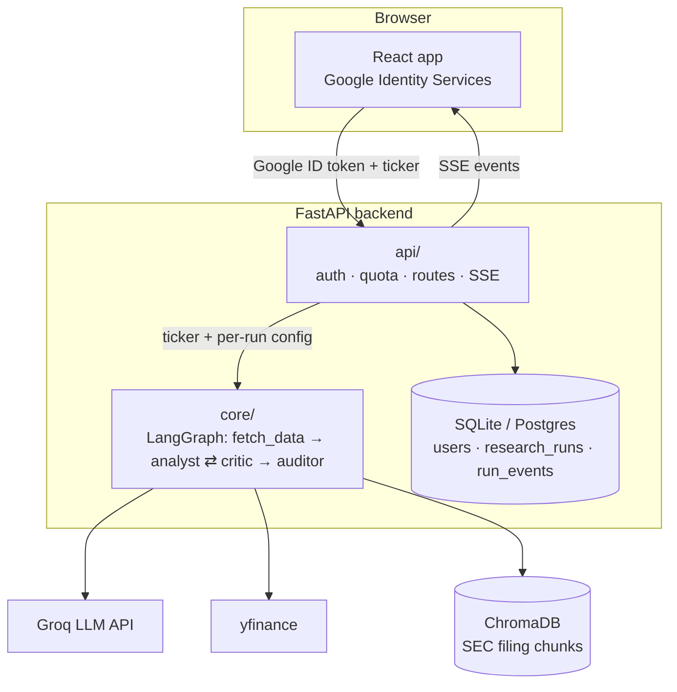
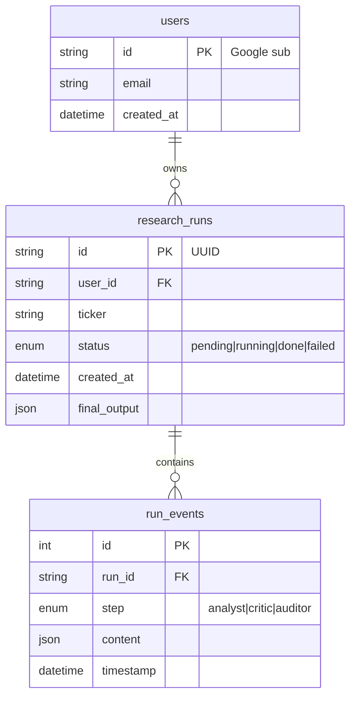
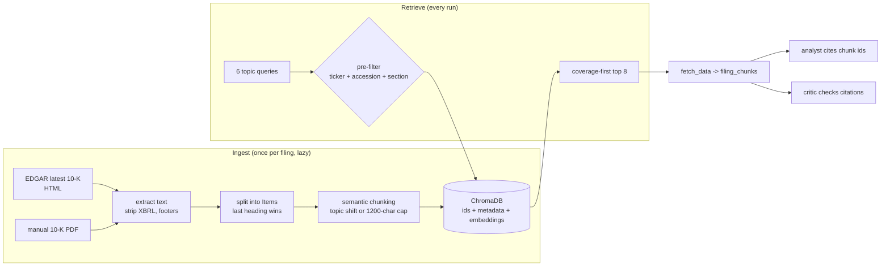
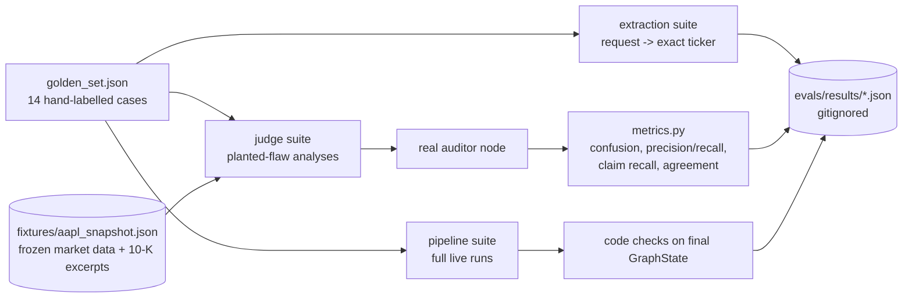

# Design: Automated Financial Research & Multi-Agent Consensus Network

## 1. Scope

**In scope**
- A user signs in with Google, submits a US stock ticker, and watches a live debate between an **Analyst** agent and a **Critic** agent.
- The debate is a LangGraph loop with a hard **iteration cap** (guardrail).
- An **Auditor** agent (LLM-as-a-Judge) checks the final claims against retrieved SEC filing text.
- Each step streams to a React UI over Server-Sent Events (SSE) and is stored per user (history page).
- A standalone eval harness (golden set + judge calibration) measures quality offline.

**Out of scope**
- Investment advice, trading or portfolio features.
- Real-time tick data; yfinance snapshots are enough.
- Non-US exchanges (tickers with exchange suffixes like `RELIANCE.NS` are rejected).
- Our own financial logic: all financial reasoning lives in LLM prompts (`core/prompts.py`). Code only moves data in and validated structured output out.

## 2. Agent graph

- `fetch_data`: pulls market data (yfinance) and relevant SEC filing chunks (ChromaDB) into state.
- `analyst`: produces an `AnalystOutput` (thesis, data points, reasoning, confidence, citations).
- `critic`: produces `CriticFeedback` (agrees, objections, missing context).
- `consensus_check` (guardrail). `max_iterations` = maximum Analyst rounds **in total** (default 3); `iteration_count` = completed rounds.
  - After each critic step, the `consensus_check` node increments `iteration_count` and sets `forced_exit=True` if the cap is reached while the Critic still disagrees.
  - The router then returns `"done"` if `critic_feedback.agrees` is true, **or** if `iteration_count >= max_iterations`; otherwise `"continue"` (back to `analyst`).
  - Split into node + router because LangGraph routing functions cannot update state.
  - Backstop: `recursion_limit = 1 + 3 x max_iterations + 1` steps, so even a broken router cannot loop beyond about one extra round.
  - A forced exit still goes to the Auditor and is flagged as **unresolved disagreement**, so the UI and stored result never present a forced exit as consensus.
- `auditor` (LLM-as-a-Judge): runs after every debate, consensus or forced exit. It sees the final `AnalystOutput` and the same evidence the agents had, but **not** the critic's feedback, so its verdict is independent. It produces an `AuditorVerdict` (is_grounded, unsupported_claims, notes). A verdict whose `is_grounded` contradicts its `unsupported_claims` list gets one repair attempt.

Why a hard cap: two LLMs can disagree forever. Without a cap, cost and latency are unbounded and a run might never finish.

## 3. System architecture

## 4. Separation of concerns: `core/` vs `api/`

| Layer | Knows about | Does not know about |
|---|---|---|
| `core/` (graph, nodes, schemas, prompts) | tickers, market data, filings, LLM calls | users, auth, HTTP, the database |
| `api/` (auth, quota, routes) | users, tokens, quotas, persistence, streaming | how the agents reason |

- `core/` takes a ticker (plus optional run config) and returns a final `GraphState`. It never sees `user_id`.
- `api/` verifies the user, checks the quota **before** invoking the graph, persists each step as a `run_event`, and streams it.
- Per-user settings (for example a model tier) are passed into `GraphState` as plain parameters by the API layer.

Benefits: `core/` can be unit tested and evaluated (Stage 5 harness) without a web server or database, and auth bugs cannot leak into the reasoning code.

## 5. Authentication decision

**Choice:** Google Identity Services on the frontend issues a Google **ID token** (a signed JWT). The frontend sends it as `Authorization: Bearer <token>` on every request. FastAPI verifies it with `google-auth` (`id_token.verify_oauth2_token`): signature, expiry, issuer, and audience = our `GOOGLE_CLIENT_ID`. The token's `sub` claim becomes `users.id`.

- Stateless: no server-side sessions or our own JWTs to manage.
- No passwords stored.
- `sub` is stable for a Google account; email can change, so email is not the key.
- Trade-off: ID tokens expire after about 1 hour, so the frontend must refresh them; SSE needs the token too (handled in Stage 6/7).

## 6. Data model

- Every query is scoped by `user_id`; there are no cross-user reads. Scoped helpers live in `db/models.py` and are tested.
- Run ids are random UUIDs so they cannot be guessed from the SSE URL (ownership is still checked).

## 7. RAG over SEC filings (Stage 4)

- **Sources:** the latest 10-K from SEC EDGAR (HTML/inline XBRL) is downloaded automatically. A 10-K PDF can also be indexed by hand (`python -m src.rag.ingest`). Both go through the same chunker.
- **Sections:** each 10-K Item heading appears twice (table of contents, then the real section); the last occurrence marks the section start. Only Items 1, 1A, 1C, 3, 7 and 7A are indexed.
- **Semantic chunking:** paragraphs within a section are embedded. A chunk ends where neighbouring-paragraph similarity is in the section's lowest 20% (and below its median), or at 1,200 characters. Size-based breaks repeat one paragraph as overlap; tiny chunks are merged into a neighbour.
- **Metadata pre-filtering:** every vector query filters on `ticker`, `accession` (one filing) and `section` before ranking, so another company's or another year's text can never be returned.
- **Citations:** chunk ids such as `AAPL-10K-2025-1A-007` are deterministic. The Analyst must cite only ids it was given; this is enforced in code (`extra_check` → one repair attempt). The Critic sees the same excerpts. The Auditor then checks that citations actually support the claims.
- **Failure mode:** a missing filing (ETF, foreign issuer, EDGAR down) logs a warning and the debate runs on market data only.

## 8. Structured output contracts (Pydantic v2)

- `AnalystOutput`: thesis, supporting_data_points, reasoning, confidence (`low|medium|high`), filing_citations (default `[]`)
- `CriticFeedback`: agrees, objections, missing_context
- `AuditorVerdict`: is_grounded, unsupported_claims, notes
- `MarketDataToolInput`: ticker, normalized to uppercase, non-empty, no exchange suffix
- LLM-output models forbid extra fields so malformed or hallucinated output fails validation loudly instead of passing silently.

## 9. Streaming

`POST /research` creates a run (after the quota check) and returns its id. `GET /research/{id}/stream` opens an SSE stream; each graph step is saved as a `run_event` and pushed as an SSE message. `GET /history` lists the user's past runs.

## 10. Evaluation harness (Stage 5)

`backend/evals/` is a standalone tool for measuring quality. It is **not** part of the live app; nothing in `src/` imports it.

- **Extraction suite (4 cases):** a free-text request must give an exact ticker. One case (a company listed only in India) must fail cleanly, either at extraction or because the invented ticker does not exist.
- **Judge suite (7 cases):** each case is a hand-written analysis containing one planted flaw:
  - a wrong number;
  - a unit misread;
  - a period misread;
  - a citation that doesn't support its claim;
  - outside knowledge.

  Two control cases are grounded: one fully grounded analysis, and one that contains only opinions. The cases are checked against a **frozen** evidence snapshot, so labels stay correct after prices move or a new 10-K comes out. Each label holds by construction and is explained in the case's `notes` field.
- **Pipeline suite (3 cases):** full live runs (extraction → debate → auditor) for AAPL, MSFT and JPM. Each run is scored by code checks:
  - correct ticker and sector;
  - filings retrieved;
  - citations valid;
  - rounds within the cap;
  - `forced_exit` consistent with the critic's last verdict;
  - auditor ran.
- **Judge calibration** (`judge_calibration.py`) compares the auditor's verdicts with the manual labels.
  - The positive class is **ungrounded**: precision is "when it flags, is it right?" and recall is "how many planted flaws does it catch?".
  - It also reports **claim recall**: whether the auditor named the planted claim, not just the verdict.
  - With `--repeats N` it reports **agreement**: whether it gives the same verdict every time.
